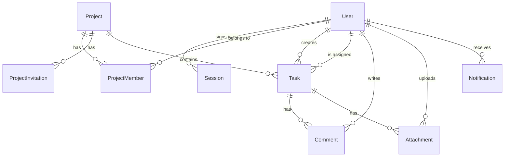

# TaskMaster – Architecture

> This is the design for the whole project. Features land phase by phase; see
> `docs/requirements-checklist.md` (added as phases complete) for what is built so far.

## 1. Overview

```
 Client (web / mobile / Postman)
   │  HTTPS: REST + JSON            WebSocket (Socket.IO)
   ▼                                   ▼
 ┌───────────────────────────────────────────────────────────┐
 │ Express 5 app (src/app.js)                                │
 │  requestLogger → helmet → CORS → json/cookies → /api/v1   │
 │  ┌──────────── modules/<feature> ─────────────┐           │
 │  │ routes → validate(Zod) → authenticate      │           │
 │  │        → controller → service → Prisma     │           │
 │  └────────────────────────────────────────────┘           │
 │  notFound → errorHandler (single place for error JSON)    │
 │                                                           │
 │  realtime/socket.js  ◄── notifications.service (emit)     │
 │  storage/ local disk (attachments)                        │
 └───────────────────────────────────────────────────────────┘
   │ Prisma 7 + pg adapter
   ▼
 PostgreSQL 16 (Docker Compose)
```

One process serves both the REST API and Socket.IO on the same port.

## 2. Code layout and layering

```
src/
  app.js            builds the Express app (no listen; tests import it)
  server.js         HTTP server + Socket.IO, graceful shutdown
  routes.js         mounts every module under /api/v1
  config/           env (validated), logger, prisma client, OpenAPI
  middleware/       requestLogger, validate, authenticate, rateLimit, upload, errorHandler, notFound
  modules/<name>/   one folder per feature
     <name>.routes.js      HTTP verbs + paths, middleware chain. No logic.
     <name>.schemas.js     Zod schemas for params / query / body
     <name>.controller.js  reads req.validated + req.user, calls the service, sends the response
     <name>.service.js     business rules, permissions, database access
     <name>.docs.js        OpenAPI description of the module
  realtime/         Socket.IO server and per-user rooms
  storage/          attachment file storage
  utils/            ApiError, response helpers, pagination, Prisma selects
scripts/smoke-test.js   end-to-end check of every user story against a running server
Dockerfile, docker-compose.yml   production image; PostgreSQL + API services
```

Rules:

- **Controllers never touch Prisma; routes never contain logic.** Services are plain async
  functions that take IDs and validated input, so they are easy to test and reuse (the
  Socket.IO handshake reuses the auth service).
- **Errors are thrown, not returned.** Services throw `ApiError`; Express 5 forwards rejected
  promises to `errorHandler`, which is the only place that formats error responses.
- **Validated input only.** Controllers read `req.validated.{params,query,body}`, never the
  raw request. Zod strips unknown keys, so a client can't set `role` or `creatorId`.
- **Explicit `select`s.** Responses are built from the `select` shapes in
  `utils/serializers.js`, so new sensitive columns can never leak by accident.

## 3. Data model



| Table                 | Key columns                                                                                                                                  | Notes                                      |
| --------------------- | -------------------------------------------------------------------------------------------------------------------------------------------- | ------------------------------------------ |
| `users`               | id, email (unique, lower-case), passwordHash, name, bio, avatarUrl                                                                           |                                            |
| `sessions`            | id, userId, refreshTokenHash, expiresAt, revokedAt, userAgent, ip                                                                            | one per signed-in device                   |
| `projects`            | id, name, description, ownerId                                                                                                               | a project is a team                        |
| `project_members`     | (projectId, userId) PK, role `OWNER/ADMIN/MEMBER`, joinedAt                                                                                  |                                            |
| `project_invitations` | id, projectId, email, invitedById, status `PENDING/ACCEPTED/DECLINED/REVOKED`, expiresAt                                                     | unique pending invite per (project, email) |
| `tasks`               | id, title, description, status `OPEN/IN_PROGRESS/COMPLETED`, priority `LOW…URGENT`, dueDate, completedAt, projectId?, creatorId, assigneeId? | indexes for the common filters             |
| `comments`            | id, taskId, authorId, body, editedAt                                                                                                         |                                            |
| `attachments`         | id, taskId, uploaderId, originalName, storageKey, mimeType, size                                                                             | file bytes live in `UPLOAD_DIR`            |
| `notifications`       | id, userId, actorId?, type, title, body, taskId?, projectId?, readAt                                                                         |                                            |

Deletes: deleting a project deletes its tasks, members and invitations; deleting a task deletes
its comments, attachments (rows and files) and notifications. Deleting a user is not exposed.

## 4. Authentication

- **Passwords**: bcrypt (cost 12 in production). Login compares against a dummy hash when the
  email is unknown so timing doesn't reveal which emails exist; both cases return the same 401.
- **Access token**: HS256 JWT, 15 min, `{ sub: userId, sid: sessionId }`, algorithm pinned.
- **Session check**: `authenticate` verifies the JWT _and_ looks up the session row. This one
  indexed query is what makes **logout immediate** (US12) and lets "change password" sign out
  other devices.
- **Refresh token**: `<sessionId>.<random 48 bytes>` in an `httpOnly`, `SameSite=Strict`
  cookie scoped to `/api/v1/auth` (also returned in the body for non-browser clients). Only a
  SHA-256 hash is stored. It is **rotated** on every refresh; replaying an old one revokes the
  session (reuse detection). Rotation is an atomic compare-and-swap on the old hash.

```
register/login ──► session row + access JWT + refresh cookie
API call ── Bearer JWT ──► authenticate: verify JWT → session active? → req.user
JWT expired ──► POST /auth/refresh (cookie) ──► new JWT + rotated refresh token
logout ──► session.revokedAt = now ──► that JWT and refresh token stop working at once
```

## 5. Authorisation

Access is decided in the services from project membership:

| Action                                 | Who                                           |
| -------------------------------------- | --------------------------------------------- |
| View project, members, tasks, comments | any member                                    |
| Update project                         | OWNER, ADMIN                                  |
| Delete project                         | OWNER                                         |
| Invite / revoke invitation             | OWNER, ADMIN (one pending invite per email)   |
| Change a member's role                 | OWNER                                         |
| Remove a member                        | OWNER (anyone but self); ADMIN (only MEMBERs) |
| Leave a project                        | any member except the OWNER                   |
| Create a task, comment, upload         | any member                                    |
| Edit a task's content / reassign it    | its creator, OWNER, ADMIN                     |
| Change a task's status                 | its assignee, its creator, OWNER, ADMIN       |
| Delete a task                          | its creator, OWNER, ADMIN                     |
| Edit a comment                         | its author                                    |
| Delete a comment / attachment          | its author/uploader, OWNER, ADMIN             |
| Personal task (no project)             | only its creator                              |

Something a user is not allowed to _see_ returns **404**, not 403, so IDs of other teams'
data can't be probed. 403 is used only when the user can see the resource but lacks the role
for the action.

## 6. Tasks: filtering, sorting, search, pagination

`GET /tasks` returns the tasks visible to the user (their projects + their personal tasks):

- Filters: `projectId`, `status` (comma list), `priority` (comma list), `assigneeId`
  (`me`, `none` or a UUID), `creatorId` (`me` or UUID), `dueFrom`, `dueTo`, `overdue=true`.
- Search: `q` matches title **or** description, case-insensitive (`ILIKE`).
- Sorting: `sortBy` = `createdAt | updatedAt | dueDate | priority | title | status`,
  `order` = `asc | desc`; `id` is always added as a tie-breaker so pages are stable.
- Pagination: `page`, `limit` (max 100). `meta` carries `total` and `totalPages`.

Setting `status: COMPLETED` stamps `completedAt`; moving away from it clears it.

## 7. Real-time notifications

- Notifications use a **transactional event pattern** (`withNotifications`): the rows are
  inserted in the **same database transaction** as the change that caused them, so a task
  update and its notifications commit or roll back together. Only after commit are they
  **pushed** with Socket.IO to the room `user:<id>` (best-effort; the stored row is the source
  of truth). Offline users read them later from `GET /notifications`.
- Duplicate invitations are prevented in the database transaction: a transaction-scoped
  advisory lock on (project, email) serialises concurrent invites before the pending check.
- The Socket.IO handshake authenticates with the same access token
  (`io(url, { auth: { token } })`) and the same session check as HTTP.
- Events: `notification` (new notification object), `notification:count` (unread count).
- Triggers: task assigned to you, task you created/are assigned to updated or completed,
  new comment on such a task, attachment added, invitation to a project. The person who
  made the change is never notified about their own action.

## 8. Generative AI (not built)

US14 was **skipped by decision** (NIK, 2026-11-23). If it is added later, the intended design
is: a small `src/ai/` service with interchangeable providers chosen by an `AI_PROVIDER` env var
(Anthropic Claude by default, OpenAI, and an offline `mock` for tests), endpoints
`POST /ai/task-description` and `POST /ai/tasks/:taskId/summary`, user text passed to the model
as escaped, tagged data, and its own rate limit.

## 9. Attachments

`multer` streams the upload to `UPLOAD_DIR` under a random name (`<uuid><ext>`); the original
name is kept only as metadata. Size is capped by `MAX_UPLOAD_MB`, and MIME types are limited
to an allowlist (images, PDF, text/CSV/Markdown, Office documents, ZIP). Downloads go through
an authenticated endpoint with `Content-Disposition: attachment` and `nosniff`, so an
uploaded file can never run as a page on the API's origin.

## 10. Errors and responses

```jsonc
{ "success": true, "data": {}, "meta": { "page": 1, "limit": 20, "total": 3, "totalPages": 1 } }
{ "success": false, "error": { "code": "VALIDATION_ERROR", "message": "…", "details": [] } }
```

Error codes: `VALIDATION_ERROR`, `INVALID_JSON`, `UNAUTHENTICATED`, `FORBIDDEN`, `NOT_FOUND`,
`CONFLICT`, `RATE_LIMITED`, `PAYLOAD_TOO_LARGE`, `UNSUPPORTED_FILE_TYPE`, `INTERNAL_ERROR`.

## 11. Testing

Vitest + Supertest against a real PostgreSQL test database (`TEST_DATABASE_URL`). The suite
applies migrations once, truncates all tables before each test, and runs files serially.
Socket.IO is tested end-to-end with `socket.io-client` against a server on a random port.
The suite needs no network access.

`npm run smoke` (`scripts/smoke-test.js`) complements the suite: it walks through every user
story over real HTTP and WebSocket against a **running** server (by default the Docker
container on port 4000), using fresh accounts each time, and prints one line per check.

## 12. Deployment (Docker)

`Dockerfile` builds a production image (`node:22-bookworm-slim`, production dependencies only,
runs as the unprivileged `node` user, health check on `/api/v1/health`). On start it runs
`prisma migrate deploy` and then the server, so a new image upgrades the schema by itself.
`prisma` is a runtime dependency for that reason.

`docker-compose.yml` runs two services: `db` (PostgreSQL 16, also creates `taskmaster_test`)
and `api` (waits for a healthy `db`, reaches it by service name, stores uploads in the
`uploads` volume). `docker compose up -d db` alone still supports running the API with
`npm run dev`. `docker stop` sends SIGTERM, which the server handles by closing sockets and
the database pool before exiting.

## 13. Known limits / next steps

- Rate-limit counters and Socket.IO rooms are in memory: one API instance. To scale out, add
  a Redis store for `express-rate-limit` and the Socket.IO Redis adapter.
- Search uses `ILIKE`; for large data add a `pg_trgm` GIN index or Postgres full-text search.
- Attachments use local disk; swap `src/storage` for S3-compatible storage in production.
- Invitations are in-app; sending emails needs an SMTP/email provider.
